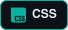
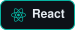
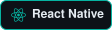
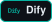

<!-- Header banner -->

  

  

  

  

---

<h2 align="center">👨‍💻 About Me</h2>

  I'm a Full Stack Engineer with nearly <b>10 years</b> of experience building <b>web</b>, <b>mobile</b> and <b>desktop</b> products
  with remote teams across the US, Latin America, Europe and Asia. 
  Over the last two years I've specialized in <b>AI</b>: integrating LLMs, RAG pipelines, agents and document processing into real products. 
  I enjoy learning and, above all, sharing what I learn.

  🔭 Currently building at <b>ClickIT</b> &nbsp;·&nbsp;
  🧑‍🏫 Technical interviewer &nbsp;·&nbsp;
  🌎 Remote from Venezuela

---

<h2 align="center">🛠️ Technologies & Tools</h2>

<h3 align="center">🌐 Web</h3>

  
  
  
  
  
  
  
  
  
  
  
  
  
   
  
  
  

<h3 align="center">📱 Mobile &nbsp;·&nbsp; 🖥️ Desktop</h3>

  
  
  
  
  
  

<h3 align="center">⚙️ Backend</h3>

  
  
  
  
  
  
   
  
  
  
  

<h3 align="center">🤖 AI & LLMs</h3>

  
  
  
  
  
  
  
  
  
   
  
  
  
  
  
  

<h3 align="center">🗄️ Databases</h3>

  
  
  
  
  
  

<h3 align="center">☁️ Cloud & DevOps</h3>

  
  
  
  
  
  
  
  
  
  
  
  

<h3 align="center">🔌 Integrations</h3>

  
  
  
  
  

---

<h2 align="center">📊 GitHub Stats</h2>

  
  

<h2 align="center">🤝 Let's Connect</h2>

  

<!-- Footer -->

  

